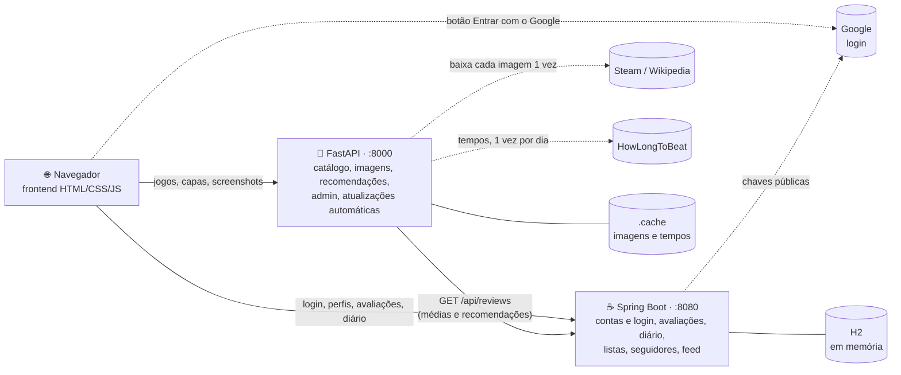

<div align="center">

# 🎮 hitBoxd

**O diário social dos seus jogos.**

Catalogue o que você joga, avalie, escreva resenhas, mantenha um diário de cada partida,
monte listas e descubra o próximo jogo com recomendações baseadas nas suas avaliações.


</div>

---

## Sumário

- [O que dá para fazer](#-o-que-dá-para-fazer)
- [Arquitetura](#-arquitetura)
- [Como rodar](#-como-rodar)
- [Variáveis de ambiente](#-variáveis-de-ambiente)
- [Contas e login](#-contas-e-login)
- [Área do administrador](#-área-do-administrador)
- [Como funciona por dentro](#-como-funciona-por-dentro)
- [Estrutura do projeto](#-estrutura-do-projeto)
- [Referência da API](#-referência-da-api)
- [Limitações](#-limitações)

---

## ✨ O que dá para fazer

| | Recurso | Descrição |
|---|---|---|
| 🕹️ | **Catálogo de jogos** | Busca por título ou desenvolvedora, filtros por gênero e plataforma e ordenação por popularidade, nota, ano ou título. |
| 🔎 | **Busca com sugestões** | Enquanto você digita no topo, aparece uma lista com jogos e pessoas (o trecho digitado fica destacado), navegável pelo teclado. Maiúsculas e acentos não importam. |
| 📄 | **Página de cada jogo** | Capa, galeria de screenshots com ampliação, descrição, um texto "para quem é", os tempos do [HowLongToBeat](https://howlongtobeat.com) e jogos parecidos. |
| ⭐ | **Avaliações** | Nota em meias estrelas, curtida, resenha (com aviso de spoiler), situação (jogando, zerado, platinado, abandonado), plataforma e data. A média aparece com estrelas proporcionais e o valor exato (ex.: **4,5**). |
| 📓 | **Diário de jogo** | Um caderno para cada jogo que você está jogando: registre cada sessão com texto, dia e horas jogadas, quantas vezes quiser por dia. |
| 📚 | **Listas** | Listas personalizadas e ranqueadas, como "Melhores RPGs" ou "Para jogar no sofá". |
| 💡 | **Recomendações** | Calculadas a partir dos jogos que você avaliou: jogos parecidos com os que você gostou, pelo conteúdo e pela opinião da comunidade. |
| 👥 | **Comunidade** | **Encontrar pessoas** por nome ou @usuário e segui-las, feed com a atividade de quem você segue, curtidas em resenhas (curtir e descurtir) e popup de seguidores no perfil. |
| ✍️ | **Textos** | Resenhas, diário, bio e descrições têm limite de caracteres com contador, mantêm as quebras de linha e as resenhas longas aparecem com "Ler mais". |
| 🔐 | **Contas** | Cadastro e login com usuário e senha ou **com a conta do Google**. Só o dono de cada conta altera os próprios dados. |
| 🔄 | **Atualizações automáticas** | Os tempos do HowLongToBeat são atualizados sozinhos em segundo plano. |
| 🛠️ | **Administrador** | Uma área protegida, onde só o admin adiciona e edita as páginas dos jogos. |

---

## 🏗️ Arquitetura

O projeto tem **dois serviços** e um **frontend sem build**:



| Serviço | Tecnologia | Responsabilidade |
|---|---|---|
| `python-api/` | **FastAPI** + Pillow | Dono do **catálogo**: dados dos jogos, capas e screenshots otimizadas, estatísticas, recomendações, jogos parecidos, área do admin e atualização automática dos tempos. Também serve o frontend. |
| `java-api/` | **Spring Boot** + JPA + H2 | Dono da **parte social**: contas e login (senha e Google), fotos de perfil, avaliações, curtidas, diário de jogo, listas, seguidores e feed. |
| `frontend/` | HTML + CSS + JavaScript puro | Página única com rotas por `#hash` que conversa com os dois serviços. |

O serviço Java guarda só o `gameId` de cada jogo. O serviço Python consulta as avaliações no Java para calcular médias, a distribuição das notas e as recomendações.

---

## 🚀 Como rodar

### Pré-requisitos

- **Python 3.11+**
- **JDK 25**. Não é preciso instalar o Maven, porque o projeto usa o wrapper `mvnw`.

### 1. Serviço da comunidade (Spring Boot)

```bash
cd java-api
./mvnw spring-boot:run          # Windows (PowerShell): .\mvnw.cmd spring-boot:run
```

### 2. Serviço de catálogo (FastAPI) + frontend

Em outro terminal:

```bash
cd python-api
python -m venv .venv
.venv/Scripts/activate          # Linux/macOS: source .venv/bin/activate
pip install -r requirements.txt
uvicorn app.main:app --port 8000
```

### 3. Abra o site

👉 **http://localhost:8000**

Também ficam disponíveis:

- 📘 Documentação interativa do FastAPI: http://localhost:8000/docs
- 🗄️ Console do H2: http://localhost:8080/h2-console (JDBC URL `jdbc:h2:mem:hitboxd`, usuário `sa`, sem senha)

> **Dica:** suba o Spring Boot primeiro. Se ele estiver fora do ar, o catálogo continua funcionando, mas o site mostra um aviso e as partes sociais ficam vazias.

---

## ⚙️ Variáveis de ambiente

Tudo é opcional: sem nenhuma variável, o site funciona, mas sem a área do admin e sem o login com o Google.

| Variável | Serviço | Para quê |
|---|---|---|
| `ADMIN_USERNAME` | FastAPI | Usuário do administrador (padrão `admin`). |
| `ADMIN_PASSWORD` | FastAPI | Senha do administrador. Sem ela, a área do admin fica desativada. |
| `HLTB_REFRESH_HOURS` | FastAPI | Intervalo, em horas, entre as atualizações automáticas dos tempos do HowLongToBeat (padrão `24`; `0` desliga). |
| `GOOGLE_CLIENT_ID` | Spring Boot | Client ID do Google para o botão **Entrar com o Google** (veja abaixo). |
| `ADMIN_EMAILS` | Spring Boot | E-mails das contas administradoras, separados por vírgula (padrão: `vitorrreg@gmail.com`). |
| `DEMO_PASSWORD` | Spring Boot | Senha das contas de exemplo. Sem ela, as contas de exemplo existem, mas não entram com senha. |

Exemplo no PowerShell:

```powershell
$env:ADMIN_PASSWORD = "uma-senha-forte"
uvicorn app.main:app --port 8000
```

E no Linux/macOS:

```bash
ADMIN_PASSWORD="uma-senha-forte" uvicorn app.main:app --port 8000
```

---

## 🔐 Contas e login

### Criar conta e entrar

Clique em **Entrar** no topo do site. Dá para:

- **criar uma conta** com nome de usuário, nome de exibição, senha (mínimo de 8 caracteres) e e-mail opcional;
- **entrar** com usuário e senha;
- **entrar com o Google**, que cria a conta na primeira vez. Se já existir uma conta com o mesmo e-mail, ela é ligada ao Google.

Depois de entrar, o botão com a sua foto abre o menu da conta: perfil, diário, listas, dados da conta (nome, bio e foto), trocar de conta e sair.

### Contas de exemplo

Ao iniciar, os serviços carregam dados de exemplo: **24 jogos, 5 usuários, 32 avaliações, 20 atualizações de diário e 5 listas**. Para entrar com essas contas, defina `DEMO_PASSWORD` ao subir o Spring Boot e use essa senha com um destes usuários:

| Usuário | Perfil |
|---|---|
| `ana_souls` | Fã de soulslike. O diário vai de Elden Ring até a platina. |
| `pedro_indie` | Indies e pixel art. Está jogando Hollow Knight. |
| `bia_rpg` | RPGs longos. |
| `lucas_coop` | Jogos cooperativos e Nintendo. Está jogando Minecraft com os amigos. |
| `marina_puzzle` | Puzzles e mistério. Está jogando Disco Elysium. |

### Configurar o login com o Google

1. No [Google Cloud Console](https://console.cloud.google.com/apis/credentials), crie uma credencial **ID do cliente OAuth** do tipo **Aplicativo da Web**.
2. Em **Origens JavaScript autorizadas**, adicione `http://localhost:8000`.
3. Suba o Spring Boot com o client ID:

   ```powershell
   $env:GOOGLE_CLIENT_ID = "1234567890-abc.apps.googleusercontent.com"
   .\mvnw.cmd spring-boot:run
   ```

O botão **Entrar com o Google** aparece sozinho quando o client ID está configurado.

---

## 🛠️ Área do administrador

Só o administrador pode **adicionar e editar jogos**. A área fica em **http://localhost:8000/#/admin** (de propósito, sem link no menu) e permite:

- adicionar jogos e editar título, ano, desenvolvedora, gêneros e plataformas;
- editar o resumo, a descrição e o texto "para quem é";
- definir o ID da Steam (capa e screenshots automáticas), uma capa e screenshots próprias e a cor de fundo;
- editar os tempos do HowLongToBeat, acompanhar a atualização automática e pedir uma atualização na hora.

Com o admin logado, cada página de jogo ganha o botão **✎ Editar página** e o topo mostra o selo **ADMIN**.

Há dois jeitos de ser administrador:

- **Conta administradora:** entre no site **com o Google** usando um e-mail da lista `ADMIN_EMAILS`. A conta vira admin na hora, e o menu da conta ganha o item **Administração**. Só vale o e-mail confirmado pelo Google: quem cria uma conta com senha digitando um desses e-mails **não** vira admin.
- **Login próprio do admin:** em `/#/admin`, com o usuário `admin` (ou o valor de `ADMIN_USERNAME`). A **senha fica na variável de ambiente `ADMIN_PASSWORD`**, definida ao subir o FastAPI (veja [Variáveis de ambiente](#-variáveis-de-ambiente)), e não fica no código nem no repositório.

---

## 🔍 Como funciona por dentro

<details>
<summary><b>💡 Recomendações baseadas nos jogos avaliados</b></summary>

<br>

`GET /api/recommendations/{userId}` usa uma recomendação **item a item**:

1. **Seu gosto em cada jogo:** cada avaliação vira um número positivo ou negativo. Nota acima de 2,75 é positiva, abaixo é negativa, e a curtida soma.
2. **Semelhança entre dois jogos** (de -1 a 1), que mistura:
   - **conteúdo (65%):** gêneros em comum (índice de Jaccard) e mesma desenvolvedora;
   - **comunidade (35%):** se as pessoas que avaliaram os dois deram notas parecidas (similaridade de cosseno). Com poucas pessoas em comum, esse peso diminui.
3. **Pontuação:** para cada jogo que você ainda não registrou, soma a semelhança com cada jogo que você avaliou, pesada pelo seu gosto nele. A média da comunidade entra como desempate.

A resposta traz também o motivo de cada recomendação, como "Porque você gostou de Hollow Knight". Quem ainda não avaliou nada recebe os jogos mais bem avaliados pela comunidade.

A mesma semelhança gera a seção **Jogos parecidos** de cada página (`GET /api/games/{id}/similar`).

</details>

<details>
<summary><b>🔐 Login e permissões</b></summary>

<br>

- **Senhas:** guardadas só como hash **BCrypt**. Uma senha errada leva 1 s para responder, o que dificulta ficar tentando.
- **Sessão:** o login devolve um token aleatório válido por 30 dias. O banco guarda apenas o hash SHA-256 do token, e o navegador o envia no cabeçalho `Authorization: Bearer <token>`.
- **Quem faz o quê:** a API descobre o usuário pelo token, nunca por um `userId` enviado no corpo do pedido. Por isso só o autor altera a própria avaliação, entrada do diário ou lista, e cada pessoa só altera a própria conta. Sem login a resposta é `401`; mexer no que é de outra pessoa dá `403`.
- **Google:** o botão do Google entrega ao navegador um *ID token* assinado. O Spring confere a assinatura com as chaves públicas do Google e verifica o emissor, o público (o seu client ID), a validade e se o e-mail foi verificado. Só então aceita o login.
- **E-mail verificado:** só o Google confirma e-mails. Se alguém criou uma conta com senha usando o e-mail de outra pessoa, o login com o Google do dono verdadeiro **não** entra nessa conta: o e-mail passa para a conta do Google. Por isso, ser admin depende de e-mail verificado.
- **Admin pela conta:** nas rotas de admin, o FastAPI aceita o token de uma conta administradora e confirma com o Spring (`GET /api/auth/me`, campo `admin`), guardando a resposta por 1 minuto.

</details>

<details>
<summary><b>✍️ Limites de texto e busca</b></summary>

<br>

| Campo | Limite |
|---|---|
| Resenha | 2000 caracteres |
| Atualização do diário | 2000 caracteres |
| Descrição de lista | 500 caracteres |
| Bio | 280 caracteres |
| Resumo / descrição / "para quem é" do jogo (admin) | 200 / 2000 / 800 caracteres |

Cada caixa de texto mostra um contador (ex.: `891/2000`), que fica em destaque perto do limite, e cresce conforme o texto. Os limites também são conferidos no servidor. Ao salvar, o Spring tira espaços no fim das linhas e junta várias linhas em branco seguidas numa só. As quebras de linha que você escreveu são mantidas na exibição, e palavras muito longas quebram em vez de estourar a tela.

A busca do topo filtra os jogos e as pessoas já carregados no navegador, então as sugestões aparecem na hora. A página **Encontrar pessoas** (`/#/people`, também no menu da conta) usa `GET /api/users?q=`, que busca por nome ou @usuário sem diferenciar maiúsculas e acentos e mostra primeiro quem começa com o termo.

</details>

<details>
<summary><b>🔄 Atualização automática dos tempos</b></summary>

<br>

O HowLongToBeat não tem API pública. Os tempos iniciais estão em [`python-api/app/game_details.py`](python-api/app/game_details.py), e uma tarefa em segundo plano no FastAPI os atualiza:

- roda pouco depois de o serviço subir e, depois, a cada `HLTB_REFRESH_HOURS` horas (padrão 24);
- busca cada jogo pelo ID da página dele no HowLongToBeat, um jogo a cada 3 segundos, para não sobrecarregar o site;
- grava os resultados em `python-api/.cache/hltb.json`, para que sobrevivam a um reinício;
- se a busca de um jogo falhar, mantém os tempos anteriores.

A página de cada jogo mostra quando os tempos foram atualizados. O admin acompanha a última e a próxima execução e pode pedir uma atualização na hora. A busca usa a biblioteca não oficial [howlongtobeatpy](https://github.com/ScrappyCocco/HowLongToBeat-PythonAPI), que pode parar de funcionar se o site mudar.

</details>

<details>
<summary><b>🖼️ Capas e screenshots leves</b></summary>

<br>

O navegador nunca baixa as imagens originais. Ele pede ao FastAPI, que:

1. baixa a original **uma única vez**: a arte vertical da Steam, ou a imagem da Wikipedia para jogos fora da Steam;
2. reduz com o **Pillow** para **WebP**:
   - capas: 360x540, cerca de 25 KB (as originais têm de 50 a 110 KB);
   - miniaturas de screenshot: 480x270, cerca de 20 KB;
   - screenshots grandes: 1280x720, cerca de 100 KB, baixadas só quando você clica para ampliar;
3. guarda o resultado em `python-api/.cache/` e o entrega com `Cache-Control` e `ETag`.

No frontend, as imagens usam `loading="lazy"`. A cor do jogo serve de fundo enquanto elas carregam e, se a capa falhar, o card mostra o título.

As imagens pertencem aos respectivos estúdios e são usadas aqui só como ilustração em um projeto acadêmico.

</details>

<details>
<summary><b>📓 Diário de jogo</b></summary>

<br>

A lateral do **Diário** mostra os jogos com atualizações e os que você marcou como "Jogando". Cada atualização tem texto, dia, horas jogadas e um aviso de spoiler opcional. Elas aparecem agrupadas por dia ("Hoje", "Ontem"...) e com a hora em que foram escritas, e o cabeçalho soma as horas jogadas.

O diário é separado da **avaliação**: quando terminar um jogo, use **★ Avaliar jogo** para dar nota e escrever a resenha.

</details>

<details>
<summary><b>👤 Fotos de perfil e curtidas</b></summary>

<br>

- **Fotos:** a foto é recortada em quadrado e reduzida para 256x256 no próprio navegador antes do envio. O Spring guarda os bytes e os entrega por `GET /api/users/{id}/avatar` com cache de 30 dias. Listas e feed levam só um `avatarVersion`, que muda a cada troca de foto.
- **Curtidas:** cada resenha guarda **quem** curtiu. O mesmo endpoint alterna entre curtir e descurtir, então cada pessoa conta uma vez só.

</details>

---

## 📁 Estrutura do projeto

```
hitboxd/
├── frontend/                  # site (servido pelo FastAPI)
│   ├── index.html
│   ├── styles.css
│   └── app.js                 # rotas, páginas, modais, login e chamadas às APIs
│
├── python-api/                # FastAPI · porta 8000
│   ├── requirements.txt
│   └── app/
│       ├── main.py            # rotas da API e arquivos estáticos
│       ├── catalog.py         # catálogo em memória e jogos iniciais
│       ├── game_details.py    # descrições, "para quem é", screenshots e tempos iniciais do HLTB
│       ├── images.py          # download, redução para WebP e cache de capas e screenshots
│       ├── recommender.py     # estatísticas, semelhança entre jogos e recomendações
│       ├── updater.py         # atualização automática dos tempos do HowLongToBeat
│       ├── admin.py           # login e sessão do administrador
│       ├── social_client.py   # cliente HTTP do serviço Java
│       └── models.py          # modelos Pydantic
│
└── java-api/                  # Spring Boot · porta 8080
    ├── pom.xml
    └── src/
        ├── main/java/br/ime/hitboxd/
        │   ├── auth/          # cadastro, login, sessões e login com o Google
        │   ├── user/          # perfis, fotos e seguidores
        │   ├── review/        # avaliações e curtidas
        │   ├── journal/       # diário de jogo
        │   ├── gamelist/      # listas personalizadas
        │   └── common/        # CORS, erros e dados de exemplo
        └── test/              # testes (inclui a verificação dos tokens do Google)
```

---

## 📡 Referência da API

Os erros voltam como `{"detail": "mensagem"}`, com status `400`, `401`, `403`, `404`, `409` ou `503`.
🔐 = exige login (`Authorization: Bearer <token>`). 🛠️ = exige o token do admin.

<details>
<summary><b>🐍 Python: catálogo (<code>:8000</code>)</b></summary>

<br>

| Método | Rota | Descrição |
|---|---|---|
| GET | `/api/games?q=&genre=&platform=&sort=popular\|rating\|year\|title` | Busca e filtra jogos, com média e nº de avaliações (versão enxuta) |
| GET | `/api/games/{id}` | Página completa de um jogo: descrição, "para quem é", HLTB e médias |
| GET | `/api/games/{id}/similar?limit=6` | Jogos parecidos |
| POST | `/api/games` | Adiciona um jogo 🛠️ |
| PUT | `/api/games/{id}` | Edita a página de um jogo 🛠️ |
| GET | `/api/games/{id}/cover` | Capa em WebP 360x540 |
| GET | `/api/games/{id}/screenshots` | Lista as screenshots (URLs da miniatura e da imagem grande) |
| GET | `/api/games/{id}/screenshots/{n}?size=thumb\|full` | Screenshot em WebP (480x270 ou 1280x720) |
| GET | `/api/games/{id}/stats` | Média, curtidas e distribuição das notas (½★ a 5★) |
| GET | `/api/genres` · `/api/platforms` | Valores para os filtros |
| GET | `/api/recommendations/{userId}?limit=8` | Recomendações baseadas nos jogos avaliados, com o motivo |
| POST | `/api/admin/login` | Login do admin (`username`, `password`) |
| GET · DELETE | `/api/admin/session` | Confere / encerra a sessão do admin 🛠️ |
| GET | `/api/admin/updates` | Situação da atualização automática dos tempos 🛠️ |
| POST | `/api/admin/updates/hltb` | Atualiza os tempos do HowLongToBeat agora 🛠️ |
| GET | `/api/health` | Status do serviço e se o serviço Java está acessível |

</details>

<details>
<summary><b>☕ Java: comunidade (<code>:8080</code>)</b></summary>

<br>

**Contas e login**

| Método | Rota | Descrição |
|---|---|---|
| GET | `/api/auth/config` | Se o login com o Google está ativo (e o client ID) |
| POST | `/api/auth/register` | Cria conta (`username`, `displayName`, `password`, `email` opcional) e já entra |
| POST | `/api/auth/login` | Entra com usuário e senha |
| POST | `/api/auth/google` | Entra com o Google (`credential` = ID token do botão do Google) |
| GET | `/api/auth/me` | Dados da própria conta, incluindo se é administradora (`admin`) 🔐 |
| POST | `/api/auth/logout` | Encerra a sessão 🔐 |

**Usuários e seguidores**

| Método | Rota | Descrição |
|---|---|---|
| GET | `/api/users?q=&limit=` | Lista os usuários; com `q`, busca por nome ou @usuário (sem diferenciar maiúsculas e acentos) |
| GET | `/api/users/{id}` | Perfil com estatísticas |
| PUT | `/api/users/{id}` | Edita nome e bio da própria conta 🔐 |
| GET | `/api/users/{id}/avatar` | Foto de perfil |
| PUT · DELETE | `/api/users/{id}/avatar` | Envia (`image/jpeg`, `png` ou `webp`, até 256 KB) / remove a própria foto 🔐 |
| GET | `/api/users/{id}/followers` | Quem segue o usuário |
| POST · DELETE | `/api/users/{id}/following/{targetId}` | Segue / deixa de seguir 🔐 |

**Avaliações e feed**

| Método | Rota | Descrição |
|---|---|---|
| GET | `/api/reviews?userId=&gameId=` | Avaliações |
| POST | `/api/reviews` | Avalia um jogo (nota, curtida, resenha, situação, plataforma, data, rejogado, spoilers) 🔐 |
| GET | `/api/reviews/{id}` | Lê uma avaliação |
| PUT · DELETE | `/api/reviews/{id}` | Edita / exclui a própria avaliação 🔐 |
| POST | `/api/reviews/{id}/like` | Curte / descurte uma resenha 🔐 |
| GET | `/api/users/{id}/diary` | Avaliações do usuário, por data |
| GET | `/api/feed?userId=&limit=20` | Atividade de quem o usuário segue (ou de toda a comunidade) |

**Diário de jogo**

| Método | Rota | Descrição |
|---|---|---|
| GET | `/api/users/{id}/journal` | Jogos do diário, com nº de atualizações, horas e situação |
| GET | `/api/users/{id}/journal/{gameId}` | Atualizações de um jogo, das mais recentes às mais antigas |
| POST | `/api/journal` | Nova atualização (`gameId`, `text`, `playedOn`, `sessionHours`, `spoilers`) 🔐 |
| PUT · DELETE | `/api/journal/{id}` | Edita / exclui a própria atualização 🔐 |

**Listas**

| Método | Rota | Descrição |
|---|---|---|
| GET | `/api/lists?ownerId=&gameId=` | Listas |
| POST | `/api/lists` | Cria uma lista 🔐 |
| GET | `/api/lists/{id}` | Lê uma lista |
| PUT · DELETE | `/api/lists/{id}` | Edita / exclui a própria lista 🔐 |
| POST | `/api/lists/{id}/games` | Adiciona um jogo (`{"gameId": 3}`) à própria lista 🔐 |
| DELETE | `/api/lists/{id}/games/{gameId}` | Remove um jogo da própria lista 🔐 |

</details>

---

## ⚠️ Limitações

- **Dados em memória:** contas, avaliações e o catálogo voltam aos dados de exemplo quando os serviços reiniciam, e as sessões abertas caem. Para persistir, troque a URL do H2 em `java-api/src/main/resources/application.properties` por um arquivo (`jdbc:h2:file:./data/hitboxd`) e o catálogo Python por um banco.
- **Sem recuperação de senha nem confirmação de e-mail:** não há envio de e-mails.
- **HowLongToBeat não oficial:** a atualização automática depende de uma biblioteca não oficial. Se ela falhar, o site continua com os últimos tempos conhecidos.
- **Rodando localmente:** sem HTTPS, os tokens trafegam em texto puro. Em produção, sirva os dois serviços atrás de HTTPS.

---

<div align="center">

Projeto acadêmico da disciplina **Laboratório de Programação II**, no IME.

</div>
