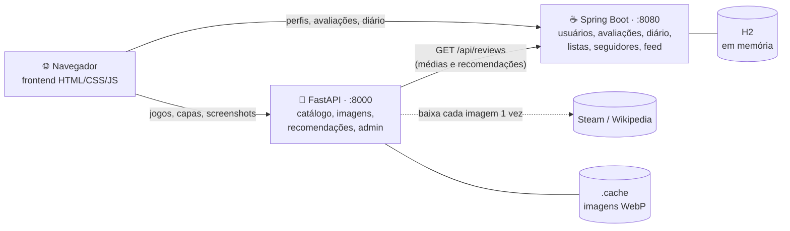

<div align="center">

# 🎮 hitBoxd

**O diário social dos seus jogos.**

Catalogue o que você joga, avalie, escreva resenhas, mantenha um diário de cada partida,
monte listas e descubra o próximo jogo com recomendações da comunidade.


</div>

---

## Sumário

- [O que dá para fazer](#-o-que-dá-para-fazer)
- [Arquitetura](#-arquitetura)
- [Como rodar](#-como-rodar)
- [Contas de exemplo](#-contas-de-exemplo)
- [Área do administrador](#-área-do-administrador)
- [Como funciona por dentro](#-como-funciona-por-dentro)
- [Estrutura do projeto](#-estrutura-do-projeto)
- [Referência da API](#-referência-da-api)
- [Limitações](#-limitações)

---

## ✨ O que dá para fazer

| | Recurso | Descrição |
|---|---|---|
| 🕹️ | **Catálogo de jogos** | Busca por título ou desenvolvedora, filtros por gênero e plataforma e ordenação por popularidade, nota, ano ou título. |
| 📄 | **Página de cada jogo** | Capa, galeria de screenshots com ampliação, descrição, um texto "para quem é" e os tempos do [HowLongToBeat](https://howlongtobeat.com). |
| ⭐ | **Avaliações** | Nota em meias estrelas, curtida, resenha (com aviso de spoiler), situação (jogando, zerado, platinado, abandonado), plataforma e data. A média aparece com estrelas proporcionais e o valor exato (ex.: **4,5**). |
| 📓 | **Diário de jogo** | Um caderno para cada jogo que você está jogando: registre cada sessão com texto, dia e horas jogadas, quantas vezes quiser por dia. |
| 📚 | **Listas** | Listas personalizadas e ranqueadas, como "Melhores RPGs" ou "Para jogar no sofá". |
| 💡 | **Recomendações** | Sugestões a partir dos seus gêneros e estúdios preferidos, do que jogadores com gosto parecido curtiram e da média da comunidade. |
| 👥 | **Comunidade** | Seguir pessoas, feed com a atividade de quem você segue, curtidas em resenhas (curtir e descurtir) e popup de seguidores no perfil. |
| 👤 | **Conta** | Menu com foto de perfil, dados da conta (nome, bio e foto), trocar de conta e sair. |
| 🛠️ | **Administrador** | Uma área protegida por senha, onde só o admin adiciona e edita as páginas dos jogos. |

---

## 🏗️ Arquitetura

O projeto tem **dois serviços** e um **frontend sem build**:



| Serviço | Tecnologia | Responsabilidade |
|---|---|---|
| `python-api/` | **FastAPI** + Pillow | Dono do **catálogo**: dados dos jogos, capas e screenshots otimizadas, estatísticas, recomendações e login do admin. Também serve o frontend. |
| `java-api/` | **Spring Boot** + JPA + H2 | Dono da **parte social**: usuários e fotos, avaliações, curtidas, diário de jogo, listas, seguidores e feed. |
| `frontend/` | HTML + CSS + JavaScript puro | Página única com rotas por `#hash` que conversa com os dois serviços. |

O serviço Java guarda só o `gameId` de cada jogo. O serviço Python consulta as avaliações no Java para calcular médias, a distribuição das notas e as recomendações.

---

## 🚀 Como rodar

### Pré-requisitos

- **Python 3.11+**
- **JDK 25**. Não é preciso instalar o Maven, porque o projeto usa o wrapper `mvnw`.

### 1. Serviço da comunidade (Spring Boot)

```bash
cd java-api
./mvnw spring-boot:run          # Windows (PowerShell): .\mvnw.cmd spring-boot:run
```

### 2. Serviço de catálogo (FastAPI) + frontend

Em outro terminal:

```bash
cd python-api
python -m venv .venv
.venv/Scripts/activate          # Linux/macOS: source .venv/bin/activate
pip install -r requirements.txt
uvicorn app.main:app --port 8000
```

### 3. Abra o site

👉 **http://localhost:8000**

Também ficam disponíveis:

- 📘 Documentação interativa do FastAPI: http://localhost:8000/docs
- 🗄️ Console do H2: http://localhost:8080/h2-console (JDBC URL `jdbc:h2:mem:hitboxd`, usuário `sa`, sem senha)

> **Dica:** suba o Spring Boot primeiro. Se ele estiver fora do ar, o catálogo continua funcionando, mas o site mostra um aviso e as partes sociais ficam vazias.

---

## 🧑‍🤝‍🧑 Contas de exemplo

Ao iniciar, os serviços carregam dados de exemplo: **24 jogos, 5 usuários, 32 avaliações, 20 atualizações de diário e 5 listas**. Clique em **Entrar** e use um destes nomes de usuário (não há senha):

| Usuário | Perfil |
|---|---|
| `ana_souls` | Fã de soulslike. O diário vai de Elden Ring até a platina. |
| `pedro_indie` | Indies e pixel art. Está jogando Hollow Knight. |
| `bia_rpg` | RPGs longos. |
| `lucas_coop` | Jogos cooperativos e Nintendo. Está jogando Minecraft com os amigos. |
| `marina_puzzle` | Puzzles e mistério. Está jogando Disco Elysium. |

Você também pode criar o seu perfil em **Entrar → Criar perfil**.

---

## 🛠️ Área do administrador

Só o administrador pode **adicionar e editar jogos**. A área fica em **http://localhost:8000/#/admin** (de propósito, sem link no menu) e permite editar:

- título, ano, desenvolvedora, gêneros e plataformas;
- resumo, descrição e texto "para quem é";
- ID da Steam (capa e screenshots automáticas), capa e screenshots próprias e cor de fundo;
- tempos do HowLongToBeat.

Com o admin logado, cada página de jogo ganha o botão **✎ Editar página** e o topo mostra o selo **ADMIN**.

### Senha do admin

O usuário é `admin` (ou o valor de `ADMIN_USERNAME`). A senha vem da variável de ambiente `ADMIN_PASSWORD`:

```powershell
# PowerShell
$env:ADMIN_PASSWORD = "uma-senha-forte"
uvicorn app.main:app --port 8000
```

```bash
# Linux/macOS
ADMIN_PASSWORD="uma-senha-forte" uvicorn app.main:app --port 8000
```

Se a variável não estiver definida, o FastAPI **gera uma senha aleatória** a cada inicialização. Ela aparece no terminal e fica gravada em `python-api/.cache/admin-password.txt`, uma pasta ignorada pelo git. Assim, o projeto nunca tem uma senha padrão.

> 🔒 A sessão do admin dura 8 horas e fica só na memória do serviço: reiniciar encerra todas. As rotas de escrita (`POST` e `PUT /api/games`) exigem o cabeçalho `Authorization: Bearer <token>`. Uma senha errada leva 1 s para responder, o que dificulta ficar tentando.

---

## 🔍 Como funciona por dentro

<details>
<summary><b>💡 Recomendações</b></summary>

<br>

`GET /api/recommendations/{userId}` combina três sinais para cada jogo que o usuário ainda não registrou:

1. **Afinidade pessoal:** cada avaliação vira uma "preferência" (nota acima de 2,75 é positiva, abaixo é negativa, e a curtida soma). Essas preferências se acumulam por gênero e por desenvolvedora.
2. **Filtragem colaborativa:** a similaridade de cosseno com outros usuários, medida nos jogos que os dois avaliaram. Os jogos que os usuários parecidos curtiram ganham pontos.
3. **Comunidade:** a média das notas, com peso que cresce com o número de avaliações.

Se o usuário ainda não avaliou nada, prevalecem os jogos mais bem avaliados pela comunidade.

</details>

<details>
<summary><b>🖼️ Capas e screenshots leves</b></summary>

<br>

O navegador nunca baixa as imagens originais. Ele pede ao FastAPI, que:

1. baixa a original **uma única vez**: a arte vertical da Steam, ou a imagem da Wikipedia para jogos fora da Steam;
2. reduz com o **Pillow** para **WebP**:
   - capas: 360x540, cerca de 25 KB (as originais têm de 50 a 110 KB);
   - miniaturas de screenshot: 480x270, cerca de 20 KB;
   - screenshots grandes: 1280x720, cerca de 100 KB, baixadas só quando você clica para ampliar;
3. guarda o resultado em `python-api/.cache/` e o entrega com `Cache-Control` e `ETag`.

No frontend, as imagens usam `loading="lazy"`. A cor do jogo serve de fundo enquanto elas carregam e, se a capa falhar, o card mostra o título. A lista de jogos também não envia os textos longos (cerca de 9 KB para 24 jogos).

As imagens pertencem aos respectivos estúdios e são usadas aqui só como ilustração em um projeto acadêmico.

</details>

<details>
<summary><b>⏱️ Tempos do HowLongToBeat</b></summary>

<br>

O HowLongToBeat não tem API pública. Por isso, os tempos (história principal, história + extras e 100%) foram levantados uma vez e gravados em [`python-api/app/game_details.py`](python-api/app/game_details.py), junto com o ID da página de cada jogo, usado no link "Dados do HowLongToBeat". O admin pode atualizar esses números pelo editor.

</details>

<details>
<summary><b>📓 Diário de jogo</b></summary>

<br>

A lateral do **Diário** mostra os jogos com atualizações e os que você marcou como "Jogando". Cada atualização tem texto, dia, horas jogadas e um aviso de spoiler opcional. Elas aparecem agrupadas por dia ("Hoje", "Ontem"...) e com a hora em que foram escritas, e o cabeçalho soma as horas jogadas.

O diário é separado da **avaliação**: quando terminar um jogo, use **★ Avaliar jogo** para dar nota e escrever a resenha.

</details>

<details>
<summary><b>👤 Fotos de perfil e curtidas</b></summary>

<br>

- **Fotos:** a foto é recortada em quadrado e reduzida para 256x256 no próprio navegador antes do envio. O Spring guarda os bytes e os entrega por `GET /api/users/{id}/avatar` com cache de 30 dias. Listas e feed levam só um `avatarVersion`, que muda a cada troca de foto.
- **Curtidas:** cada resenha guarda **quem** curtiu. O mesmo endpoint alterna entre curtir e descurtir, então cada pessoa conta uma vez só.

</details>

---

## 📁 Estrutura do projeto

```
hitboxd/
├── frontend/                  # site (servido pelo FastAPI)
│   ├── index.html
│   ├── styles.css
│   └── app.js                 # rotas, páginas, modais e chamadas às APIs
│
├── python-api/                # FastAPI · porta 8000
│   ├── requirements.txt
│   └── app/
│       ├── main.py            # rotas da API e arquivos estáticos
│       ├── catalog.py         # catálogo em memória e jogos iniciais
│       ├── game_details.py    # descrições, "para quem é", screenshots e tempos do HLTB
│       ├── images.py          # download, redução para WebP e cache de capas e screenshots
│       ├── recommender.py     # estatísticas e recomendações
│       ├── admin.py           # login e sessão do administrador
│       ├── social_client.py   # cliente HTTP do serviço Java
│       └── models.py          # modelos Pydantic
│
└── java-api/                  # Spring Boot · porta 8080
    ├── pom.xml
    └── src/main/java/br/ime/hitboxd/
        ├── user/              # usuários, fotos e seguidores
        ├── review/            # avaliações e curtidas
        ├── journal/           # diário de jogo
        ├── gamelist/          # listas personalizadas
        └── common/            # CORS, erros e dados de exemplo
```

---

## 📡 Referência da API

Os erros voltam como `{"detail": "mensagem"}`, com status `400`, `401`, `404` ou `409`.

<details>
<summary><b>🐍 Python: catálogo (<code>:8000</code>)</b></summary>

<br>

| Método | Rota | Descrição |
|---|---|---|
| GET | `/api/games?q=&genre=&platform=&sort=popular\|rating\|year\|title` | Busca e filtra jogos, com média e nº de avaliações (versão enxuta) |
| GET | `/api/games/{id}` | Página completa de um jogo: descrição, "para quem é", HLTB e médias |
| POST | `/api/games` | Adiciona um jogo 🔒 **admin** |
| PUT | `/api/games/{id}` | Edita a página de um jogo 🔒 **admin** |
| GET | `/api/games/{id}/cover` | Capa em WebP 360x540 |
| GET | `/api/games/{id}/screenshots` | Lista as screenshots (URLs da miniatura e da imagem grande) |
| GET | `/api/games/{id}/screenshots/{n}?size=thumb\|full` | Screenshot em WebP (480x270 ou 1280x720) |
| GET | `/api/games/{id}/stats` | Média, curtidas e distribuição das notas (½★ a 5★) |
| GET | `/api/genres` · `/api/platforms` | Valores para os filtros |
| GET | `/api/recommendations/{userId}?limit=8` | Recomendações personalizadas |
| POST | `/api/admin/login` | Login do admin (`username`, `password`); devolve um token de 8 h |
| GET · DELETE | `/api/admin/session` | Confere / encerra a sessão do admin |
| GET | `/api/health` | Status do serviço e se o serviço Java está acessível |

</details>

<details>
<summary><b>☕ Java: comunidade (<code>:8080</code>)</b></summary>

<br>

**Usuários e seguidores**

| Método | Rota | Descrição |
|---|---|---|
| GET · POST | `/api/users` | Lista os usuários / cria um perfil |
| GET · PUT | `/api/users/{id}` | Perfil com estatísticas / edita nome e bio |
| GET | `/api/users/{id}/avatar` | Foto de perfil |
| PUT · DELETE | `/api/users/{id}/avatar` | Envia a foto (`image/jpeg`, `png` ou `webp`, até 256 KB) / remove a foto |
| GET | `/api/users/{id}/followers` | Quem segue o usuário |
| POST · DELETE | `/api/users/{id}/following/{targetId}` | Segue / deixa de seguir |

**Avaliações e feed**

| Método | Rota | Descrição |
|---|---|---|
| GET | `/api/reviews?userId=&gameId=` | Avaliações |
| POST | `/api/reviews` | Avalia um jogo (nota, curtida, resenha, situação, plataforma, data, rejogado, spoilers) |
| GET · PUT · DELETE | `/api/reviews/{id}` | Lê, edita ou exclui uma avaliação |
| POST | `/api/reviews/{id}/like?userId=` | Curte / descurte uma resenha |
| GET | `/api/users/{id}/diary` | Avaliações do usuário, por data |
| GET | `/api/feed?userId=&limit=20` | Atividade de quem o usuário segue (ou de toda a comunidade) |

**Diário de jogo**

| Método | Rota | Descrição |
|---|---|---|
| GET | `/api/users/{id}/journal` | Jogos do diário, com nº de atualizações, horas e situação |
| GET | `/api/users/{id}/journal/{gameId}` | Atualizações de um jogo, das mais recentes às mais antigas |
| POST | `/api/journal` | Nova atualização (`userId`, `gameId`, `text`, `playedOn`, `sessionHours`, `spoilers`) |
| PUT · DELETE | `/api/journal/{id}` | Edita / exclui uma atualização (o DELETE exige `?userId=` do dono) |

**Listas**

| Método | Rota | Descrição |
|---|---|---|
| GET · POST | `/api/lists?ownerId=&gameId=` | Listas / cria uma lista |
| GET · PUT · DELETE | `/api/lists/{id}` | Lê, edita ou exclui uma lista |
| POST | `/api/lists/{id}/games` | Adiciona um jogo (`{"gameId": 3}`) |
| DELETE | `/api/lists/{id}/games/{gameId}` | Remove um jogo da lista |

</details>

---

## ⚠️ Limitações

- **Login simplificado para usuários:** a entrada pede só o nome de usuário, sem senha, e a API social confia no `userId` enviado. Apenas a área do administrador tem senha e token.
- **Dados em memória:** tudo volta aos dados de exemplo quando os serviços reiniciam. Para persistir, troque a URL do H2 em `java-api/src/main/resources/application.properties` por um arquivo (`jdbc:h2:file:./data/hitboxd`) e o catálogo Python por um banco.
- **Tempos do HowLongToBeat fixos:** não se atualizam sozinhos. O admin pode editá-los pelo painel.

---

<div align="center">

Projeto acadêmico da disciplina **Laboratório de Programação II**, no IME.

</div>
